<picture>
  <source media="(prefers-color-scheme: dark)" srcset="assets/banner-dark.svg">
  
</picture>

I move data from places that don't want to give it up to people who need to trust it. The goal is always the same: a pipeline nobody has to think about at 3 a.m.

### House rules

- **Run it twice, get the same answer.** Re-runs never create duplicates.
- **Every number has a receipt.** Any value in a report traces back to the exact response it came from.
- **One command from a clean checkout.** If setup needs a wiki page, the setup is the bug.
- **Tests don't need the internet.** Record real responses once, replay them forever.

Python · SQL · dbt · Dagster · Airflow · DuckDB · Postgres · ClickHouse · Kafka · Grafana · Docker

### Selected work

| Project | What it shows |
|---|---|
| [**worldbank-indicators-pipeline**](https://github.com/brow1998/worldbank-indicators-pipeline) | Config-driven ingestion from the World Bank API, content-addressed raw layer, dbt dimensional model on DuckDB, data-quality tests, Dagster assets with lineage |
| [**grafana-poc**](https://github.com/brow1998/grafana-poc) | Streaming telemetry for an LLM-as-a-Service platform: Redpanda → ClickHouse, Prometheus and Loki, five Grafana dashboards for five different audiences |
| [**jobsity**](https://github.com/brow1998/jobsity) | On-demand CSV ingestion through Kafka into ClickHouse, with Metabase on top |
| [**hippo-challenge**](https://github.com/brow1998/hippo-challenge) | Validating and joining pharmacy, claim and revert feeds into per-drug pricing metrics and recommendations |
| [**data-of-fire-challenge**](https://github.com/brow1998/data-of-fire-challenge) | A two-hour mini warehouse for San Francisco fire incidents: extraction, SQL modeling, Metabase |

### After hours

I can't stop building small products for problems I actually have. [**spotidraft**](https://github.com/brow1998/spotidraft) turns YouTube uploads into Spotify for Creators drafts, because doing it by hand twice was once too many. [**empreita**](https://github.com/brow1998/empreita) is a construction management PWA for architects and the clients who keep asking "how much is left?".
